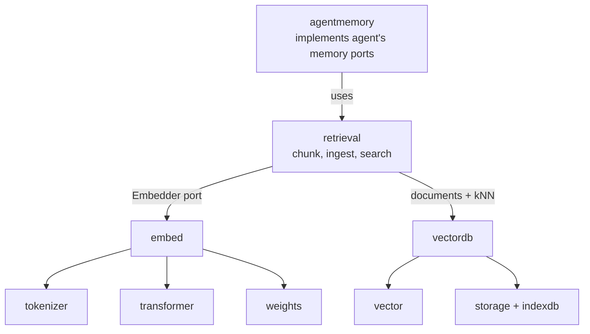

# Architecture — `webtyp/retrieval`

## What this is

`retrieval` is the part of **RAG** (retrieval-augmented generation) that finds things. Given a
question, it returns the few pieces of stored text most related to it, so the agent can put
those pieces, and not whole documents, in front of the model. The "generation" half belongs
to the agent and the model.

You meet it when a user uploads a document in the browser and later asks about it. The
document is split into chunks, each chunk is turned into a vector (a list of numbers that
captures its meaning), and a question is answered by finding the chunks whose vectors are
closest to the question's vector.

It exists to own two jobs that no repository did:

1. **Chunking**: splitting a document into pieces of at most 256 tokens (decision D4c of the
   semantic-search plan). The plan assigned this to "whoever uploads the document", and no
   code does it today.
2. **The semantic-search plan itself**: the document that explains how the browser-native
   search stack was designed and what is still pending.

## Where it sits

- `retrieval` knows nothing about the agent. `agentmemory` uses it to implement the agent's
  `KnowledgeStore`, and later the tool index behind `search_tools`.
- It depends on the `embed.Embedder` **interface** and on `vectordb`. It never picks the
  embedding model. The composition root does that.

## The semantic-search stack (already built)

[SEMANTIC_SEARCH_MASTER_PLAN.md](SEMANTIC_SEARCH_MASTER_PLAN.md) is the master index: 128-dim
Matryoshka vectors from `bekko-embedding-v1-a8m`, a full scan over a shared arena, and storage
on IndexedDB. Phases 1–4 are published. Its "Pendiente" section lists what is left.

## Research and history

- [Embedding model choice](SMALL_MODEL_FOR_EMBEDING.md): candidates and method (historical,
  and the master plan's D0/D5 override its numbers).
- [Cloudflare Workers AI](CLOUDFLARE_AI_WORKER.md): why the hosted catalogue was ruled out as
  the model source.
- [Semantic search wave](history/SEMANTIC_SEARCH_WAVE.md): every correction and decision on
  the way (frozen).
- [WebGPU encoder](history/WEBGPU_ENCODER.md): archived, not cancelled.

## Open decisions before the first plan

These are listed in the
[ecosystem master plan](https://github.com/webtyp/agent/blob/main/docs/AGENT_ECOSYSTEM_MASTER_PLAN.md).
No `docs/PLAN.md` is written until they are answered:

- ~~how the chunker counts tokens~~: resolved. `embed.Embedder.CountTokens(text)` (embed v0.3.0)
  answers with the embedding model's own tokenizer, and the chunker uses it,
- the name of the repository `embed`'s real adapter (`StaticEmbedder`) moves to. The move is
  decided, and `retrieval` must only ever depend on the `embed` contract.
